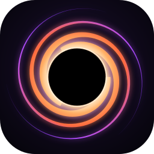
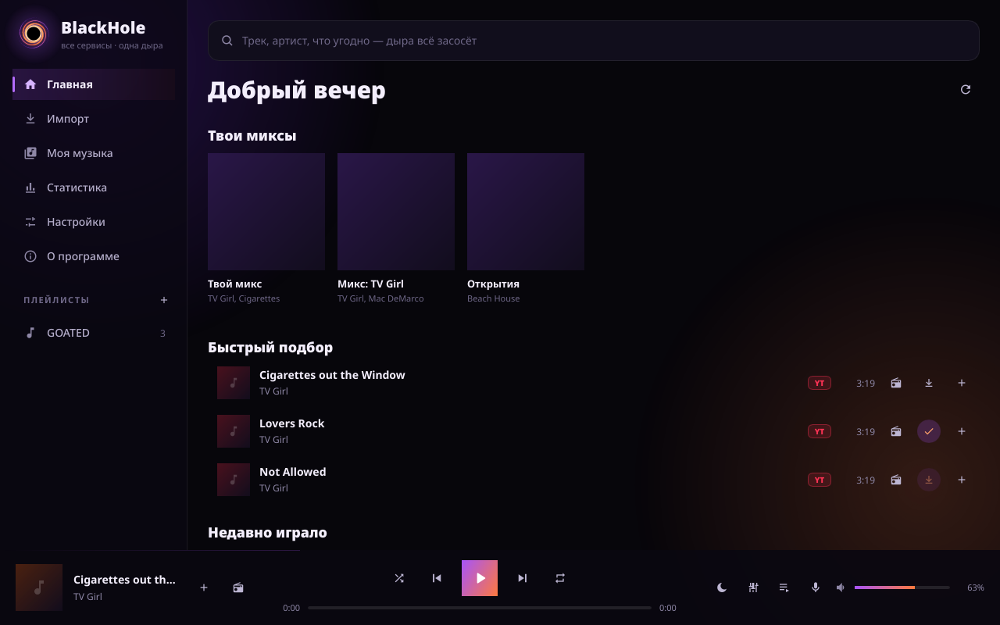
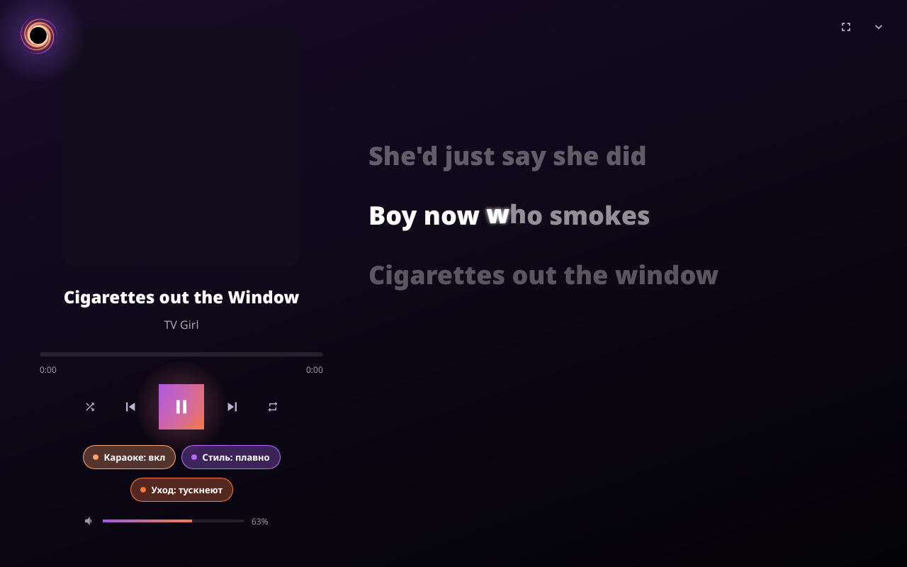
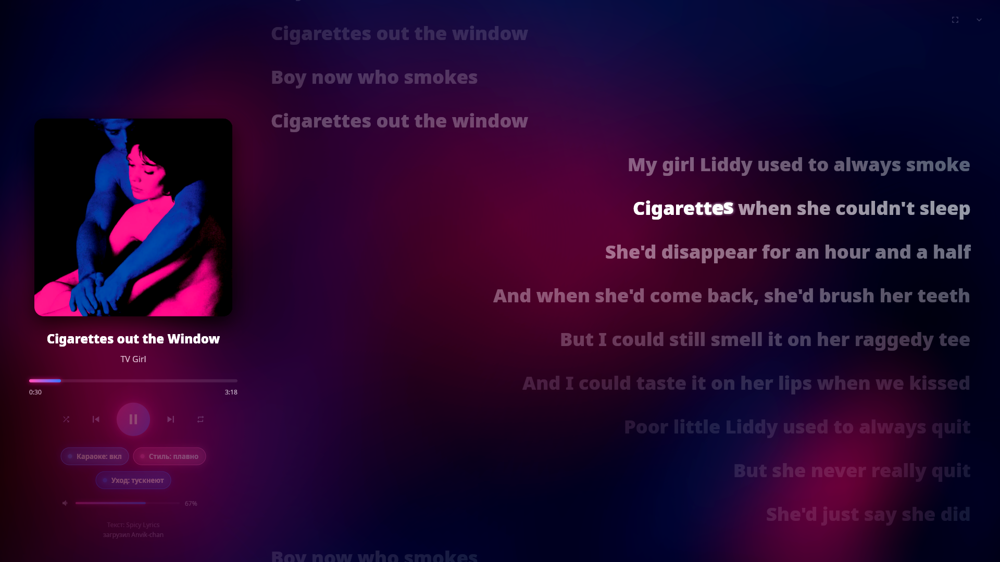
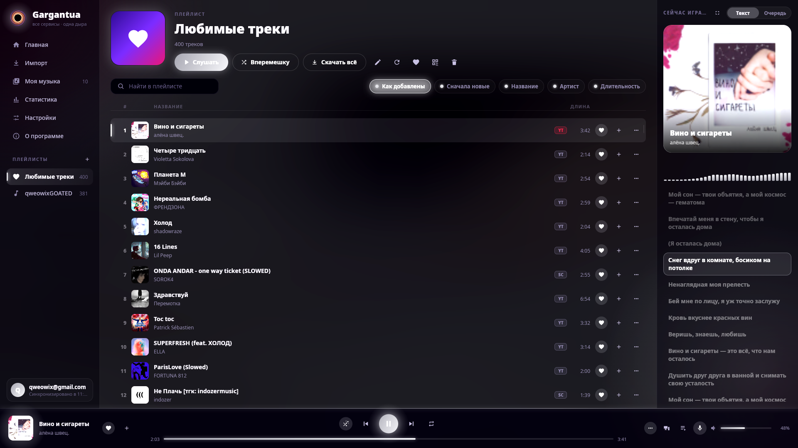
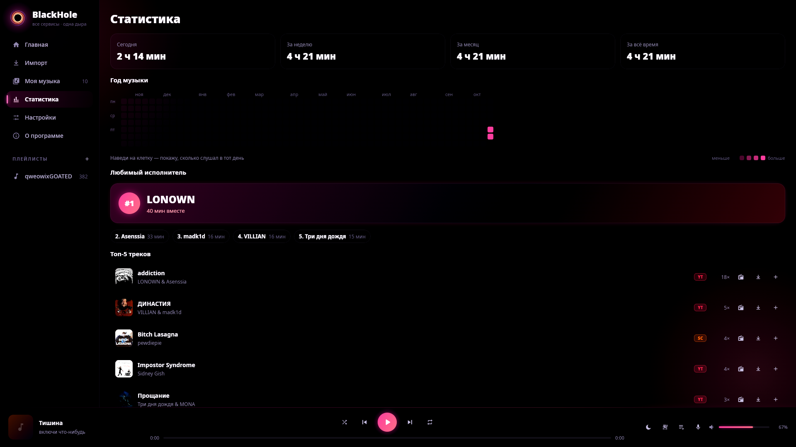
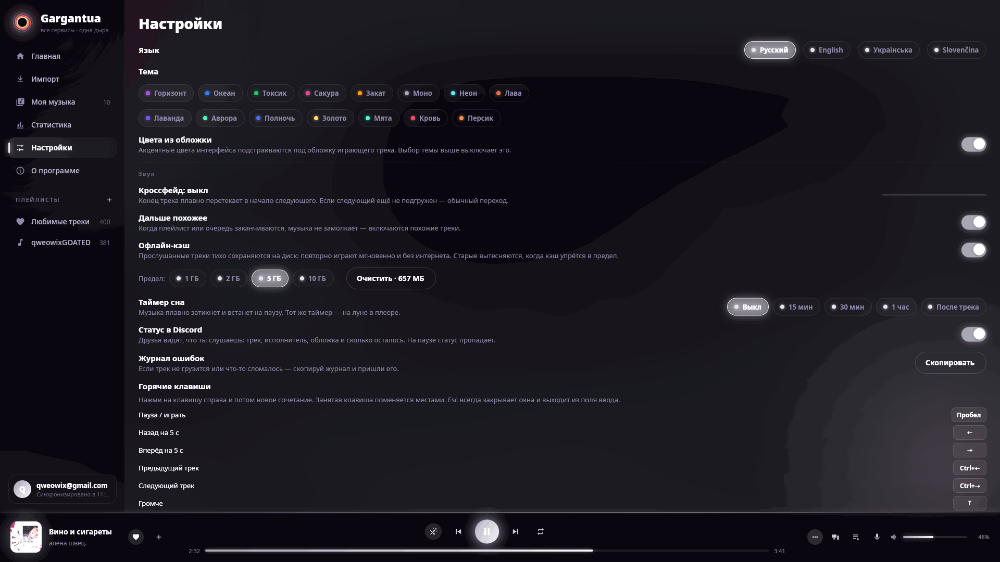
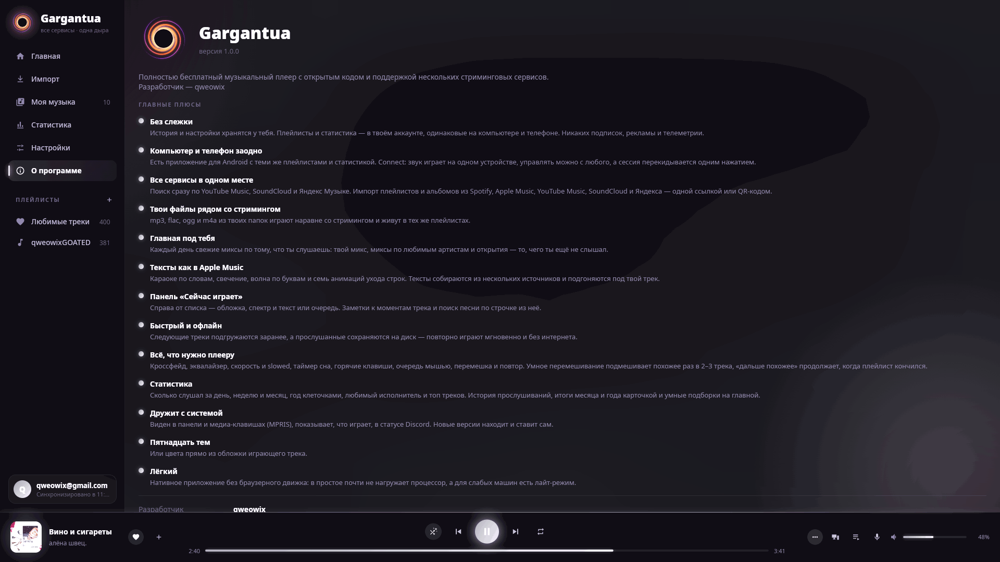

<p align="center">
  
</p>

<h1 align="center">BlackHole</h1>

<p align="center">
  <b>Все сервисы — одна дыра.</b><br>
  Бесплатный музыкальный плеер для Linux и Windows: YouTube Music, SoundCloud, Spotify, Apple Music, Яндекс Музыка и твои файлы — в одном окне. Без рекламы, аккаунт не обязателен, всё хранится у тебя.
</p>

<p align="center">
  <a href="https://github.com/qweowix/blackhole/releases/latest"><b>Скачать</b></a> ·
  <a href="https://t.me/BlackHolePlayer">Telegram</a> ·
  <a href="#english">English</a>
</p>



## Что умеет

- **Один поиск по всем сервисам.** YouTube Music, SoundCloud, Яндекс Музыка; артисты и альбомы каруселями сверху, результаты по мере набора.
- **Импорт плейлистов по ссылке** из Spotify, Apple Music, YouTube Music, SoundCloud и Яндекса. Треки из Spotify и Apple сразу подбираются на YouTube Music; сомнительные совпадения плеер показывает и спрашивает.
- **Тексты песен по словам**, как в Apple Music: караоке-заливка, бэк-вокал и дуэты, несколько стилей и эффектов ухода строки (тускнеют, сдув, в дыру, падение, взрыв…). Источники — lrclib, Liriqo, Spicy Lyrics.
- **Локальные файлы** рядом со стримингом: папки с музыкой, теги и обложки из файлов.
- **Главная с миксами** — «Твой микс», миксы по любимым артистам и «Открытия», обновляются каждый день по тому, что ты слушаешь.
- **Статистика**: сегодня, неделя, месяц, год прослушиваний квадратиками как на GitHub, любимый артист и топ треков.
- **Офлайн-кэш**: дослушанные треки тихо сохраняются на диск и потом играют без интернета. Лимит размера — в настройках.
- **Скачивание в mp3** с тегами и обложкой.
- **Звук**: кроссфейд, 10-полосный эквалайзер с пресетами, скорость 0.5–2× (с тональностью или как slowed / sped up), таймер сна.
- **Горячие клавиши**, все переназначаются в настройках.
- **Радио по треку** и «дальше похожее», когда плейлист закончился.
- **Discord**: статус «Слушает» с обложкой и кнопкой на трек.
- **15 тем** плюс тема в цвет обложки текущего трека.
- **Обмен плейлистами через QR-код.**
- **Аккаунт по желанию**: вход по почте, и плейлисты одинаковые на всех компьютерах. Синхронизируются при запуске, раз в минуту и по кнопке. Настройка своего Firebase — [docs/firebase.md](docs/firebase.md).
- Медиа-клавиши и системные контролы (MPRIS на Linux), русский / английский / украинский интерфейс.
- **Лёгкий**: нативный интерфейс на Rust и Slint, без браузерного движка внутри.

| | |
|---|---|
|  |  |
|  |  |
|  |  |

## Установка

### Windows

1. Скачай `BlackHole-windows-x86_64.zip` из [релизов](https://github.com/qweowix/blackhole/releases/latest).
2. Распакуй куда угодно и запусти `BlackHole.exe`.

mpv и yt-dlp уже лежат в папке `bin`, ставить ничего не надо. Для скачивания в mp3 положи туда же `ffmpeg.exe`.

### Linux

1. Поставь зависимости:
   ```sh
   # Arch / CachyOS / Manjaro
   sudo pacman -S mpv yt-dlp python
   # Debian / Ubuntu
   sudo apt install mpv python3 pipx && pipx install yt-dlp
   # Fedora
   sudo dnf install mpv yt-dlp python3
   ```
   `ffmpeg` нужен только для скачивания в mp3.
2. Скачай `BlackHole-linux-x86_64.tar.gz` из [релизов](https://github.com/qweowix/blackhole/releases/latest), распакуй и запусти `./install.sh` — плеер появится в меню приложений и в `~/.local/bin`. Или просто запусти `./blackhole` из папки.

yt-dlp лучше держать свежим (`yt-dlp -U` или через пакетный менеджер): YouTube постоянно что-то меняет. В дистрибутивах со старым yt-dlp ставь его через pipx.

### macOS

Готовой сборки пока нет, собирается из исходников: `tools/build-macos.sh` (нужны `brew install mpv yt-dlp`).

## Если YouTube пишет «Sign in to confirm you're not a bot»

Иногда YouTube помечает IP (общежитие, общий NAT) и перестаёт отдавать звук без входа. Открой настройки → **Куки YouTube** и выбери браузер, в котором ты залогинен в YouTube. Плеер сначала пробует без кук и подключает их, только когда YouTube отказал.

## Горячие клавиши

| Клавиша | Действие |
|---|---|
| `Space` | пауза / играть |
| `←` / `→` | перемотка назад / вперёд |
| `Ctrl+←` / `Ctrl+→` | предыдущий / следующий трек |
| `↑` / `↓` | громкость |
| `M` | без звука |
| `L` | текст песни |
| `S` / `R` | перемешать / повтор |
| `F` | во весь экран |
| `Ctrl+F` | поиск |
| `Ctrl+R` | синхронизировать плейлисты с аккаунтом |

Любую можно переназначить в настройках. Клавиши работают по месту на клавиатуре, раскладка не важна.

## Где лежат данные

| | Linux | Windows |
|---|---|---|
| плейлисты и настройки | `~/.config/BlackHole/` | `%APPDATA%\BlackHole\` |
| статистика | там же, `stats.json` | там же |
| кэш (тексты, обложки, офлайн-треки) | `~/.cache/BlackHole/` | `%LOCALAPPDATA%\BlackHole\` |
| скачанные mp3 | `~/Music/BlackHole` (меняется в настройках) | `Музыка\BlackHole` |

## Сборка из исходников

Нужен Rust (stable).

```sh
git clone https://github.com/qweowix/blackhole
cd blackhole
cargo build --release
./target/release/blackhole
```

На Linux для сборки нужны заголовки fontconfig, freetype и xkbcommon (на Ubuntu: `libfontconfig1-dev libfreetype-dev libxkbcommon-dev`). На Windows — обычный MSVC-тулчейн; иконка exe вшивается сама. mpv и yt-dlp плеер ищет рядом с exe, в `bin/` рядом с exe, в `PATH` и в `~/.local/bin`.

Тесты: `cargo test --release`. Снимки интерфейса без окна (программным рендером) — `cargo test --release -- --ignored shots`, картинки появятся в `target/shots/`.

Релизы собирает GitHub Actions (`.github/workflows/release.yml`): пушнул тег `v*` — Linux- и Windows-архивы появились в Releases.

### Как устроено

- Интерфейс — [Slint](https://slint.dev) со Skia-рендером, весь в `ui/app.slint`.
- Звук — [mpv](https://mpv.io) по JSON IPC, ссылки на потоки — [yt-dlp](https://github.com/yt-dlp/yt-dlp), который живёт в фоне и не запускается заново на каждый трек.
- Поиск и импорт — внутренние веб-API сервисов, ключи и аккаунты не нужны.
- Аккаунты — Firebase Auth и Firestore по REST (`src/cloud.rs`), проект задаётся переменными при сборке, см. [docs/firebase.md](docs/firebase.md).
- Переводы — `lang/*/LC_MESSAGES/blackhole.po`.

## Благодарности

[lrclib](https://lrclib.net), Liriqo и [Spicy Lyrics](https://spicylyrics.org) — тексты песен. [mpv](https://mpv.io) и [yt-dlp](https://github.com/yt-dlp/yt-dlp) — без них ничего бы не играло.

## Лицензия

[GPL-3.0](LICENSE): код можно брать, менять и распространять, но любая выложенная версия тоже должна быть открытой под GPL.

---

<a name="english"></a>
## English

**BlackHole** is a free music player for Linux and Windows. It searches YouTube Music, SoundCloud and Yandex Music at once, imports playlists from Spotify, Apple Music and others by link, plays your local files, and shows word-by-word synced lyrics with karaoke effects. It has no ads, and an account is optional: sign in with email to keep your playlists in sync across computers. Everything else is stored locally.

Also included: daily mixes, listening stats with a GitHub-style heatmap, an offline cache, mp3 downloads, crossfade, an EQ, a sleep timer, rebindable hotkeys, Discord Rich Presence, 15 themes plus a cover-coloured theme, QR playlist sharing, and an English/Russian/Ukrainian UI.

**Install:** grab the archive for your OS from [Releases](https://github.com/qweowix/blackhole/releases/latest).
- **Windows:** unzip it and run `BlackHole.exe`; mpv and yt-dlp are bundled.
- **Linux:** install `mpv`, `yt-dlp` and `python3`, unpack the archive and run `./install.sh`.

**Build from source:** `cargo build --release`.

**License:** [GPL-3.0](LICENSE).
